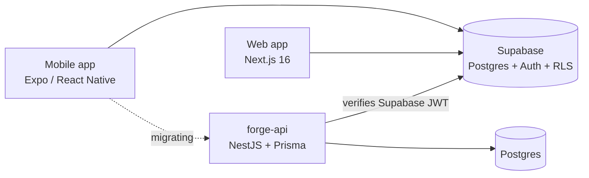

# Forge

**A strength-training and nutrition log for iOS, Android and the web.**
Write programs, log sets in one tap, track food against derived targets, and send workouts to the people you train with.

*Coming soon to the App Store and Google Play.*

<!-- TODO: add 3–4 phone screenshots to docs/screenshots/ and uncomment

-->

> **The source is private.** This repository is a write-up of how Forge is built and why it is built that way. I'm happy to walk through the code live in an interview.

---

## At a glance

| | |
|---|---|
| **Role** | Solo: product, design, mobile, web, backend, release |
| **Mobile** | Expo SDK 57 · React Native 0.86 (New Architecture) · React 19 · expo-router · NativeWind · Reanimated 4 |
| **Web** | Next.js 16 (App Router) · Tailwind 4 · Framer Motion · Supabase SSR |
| **Backend** | Supabase (Postgres, Auth, Row Level Security, RPCs), moving into a **NestJS + Prisma** API one module at a time |
| **Quality** | Jest / Vitest, mutation-tested core logic, CI against a real Postgres 17, Sentry |
| **Scope** | 27 mobile screens · 1,380-exercise catalogue · Turkish + English · metric + imperial |

---

## What it does

**Workouts.** You build a program from a 1,380-exercise catalogue and give each set its own rep range, RIR, rest time and notes, so a 12 / 10 / 8 pyramid is just as easy to write as three straight sets. Starting a session copies those sets into the log. Each set shows its target under the number you actually lifted, a rest timer runs between sets, and personal records are flagged as you log them.

**Every exercise, drawn.** Every movement has a vector figure that is rendered on the device. There are no photos or GIFs, so figures load instantly, work offline and match the app's art style.

**Nutrition.** You never type calorie and macro targets in. They are worked out from your profile (Mifflin-St Jeor, then adjusted for activity and goal), so the targets follow your weight instead of going stale. Food search finds the same entry whether you type Turkish or English.

**Progress.** Body weight is shown as a 7-day moving average with a trend that knows your goal, so it isn't just your last weigh-in. Each exercise has its own progress chart. Your profile shows a year of training as a heatmap: one tile per session, warmer the harder it was.

**Social, opt-in.** Usernames, search, follows and blocking. When two people follow each other, either one can write a program *for* the other and send it. Once accepted, it lands in the recipient's account with the prescription intact and credited to whoever wrote it.

**Privacy.** No ads and no analytics SDKs. Crash reports carry an account id and nothing else, never weight, food or training data. Deleting your account removes everything attached to it.

---

## Architecture

- **Three clients, one source of truth.** The mobile app and the web app share the same Supabase schema, RPCs and domain rules.
- **Strangler-pattern migration.** The NestJS API takes over one domain module at a time (workouts, sessions, nutrition, social, …). Identity stays in Supabase for now: the API verifies the Supabase JWT and uses its `sub` as the user id, so both systems can run side by side while data moves over.
- **The schema lives in SQL migrations, not in `schema.prisma`.** Check constraints, triggers and the case-insensitive username index can't be expressed in Prisma's schema language, so they exist only in migration SQL.

---

## Engineering highlights

### Privacy enforced by the database
The `profiles` table holds body metrics, and Row Level Security works per row, not per column. So **no other user can ever read `profiles`.** All social features go through `security definer` functions that return only public columns. A later audit tightened this further: RPCs that were callable without signing in were closed off, and `anon` lost its grants on tables and functions.

### Mutation-testing the tests
Passing tests don't prove much, so I injected 28 mechanical faults into the workout-calculation module (flipped comparisons, changed `??` defaults, swapped `&&`/`||`). The first round caught **22 of 28**. All six survivors were the same blind spot: null handling. I added tests until the score was **28/28**.

The same blind spot existed in SQL. A test fixture checks that the TypeScript and SQL versions of the ranking rule agree, but it was too weak to tell `coalesce(weight, 0)` from `coalesce(weight, 1)`. In production that bug would have let an empty weight column outrank a real bodyweight set. One added fixture row now catches it on both sides.

### One rule, two languages, kept in sync
Some rules exist in TypeScript (for the UI) and in SQL (for rankings and RPCs). A parity test runs the same fixtures through both, so the two copies can't quietly drift apart.

### CI against a real Postgres
Every push of the API runs lint, build, `migrate deploy` on an empty `postgres:17`, the seed, and the full test suite. Tests plan real exercises and search the real food catalogue, not mocks.

### Details that make it feel native
- An **animated splash** takes over from the native launch screen on exactly the same frame, so the app never flashes underneath. The logo "heats up" by cross-fading an ember copy of the mark over a cold-iron one, because react-native-svg can't animate gradient stops on the UI thread.
- **Brand assets are generated.** App icons, the favicon and the splash mark are all rendered by a script from the same geometry the in-app SVG uses.
- Accessibility pass, haptics, long-press reordering and swipe-to-delete.
- Fully localized in Turkish and English, with metric/imperial units that follow the device setting.

### Learned the hard way
- **Don't build iOS apps inside iCloud Drive.** The sync daemon stamps `FinderInfo` onto build products mid-build, and `codesign` rejects them.
- **CocoaPods needs `LANG` set**, or it fails halfway through `pod install` on Unicode paths.
- **`prisma migrate diff --from-migrations` replays migration history into your real database**, not the shadow one, and wipes it. Now documented, with a read-only drift check instead.

---

## Demo

<!-- TODO: drag video/out/forge-promo.mp4 into the GitHub editor and paste the link here -->
Video coming soon. The promo video is built in code with [Remotion](https://www.remotion.dev/): scenes written as React components and rendered to MP4.

---

## Process

I keep a running backlog in which every closed item records *why* the decision went the way it did, including what I deliberately chose not to do. A few entries from it:

- Two quick taps could open two workout sessions at once, and the first one would be stranded with its logged sets. A client-side check followed by an insert isn't atomic, so the real fix was a partial unique index in Postgres. The client handles the conflict by resuming the session that won.
- Tab screens were loading on mount instead of on focus, so their data went stale.
- The reminder time showed as `9 : 0`.
- Heatmap month labels broke in the middle of words.

---

Built by **Taner Acar** · [GitHub](https://github.com/taneracar)

